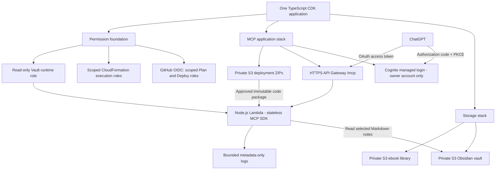
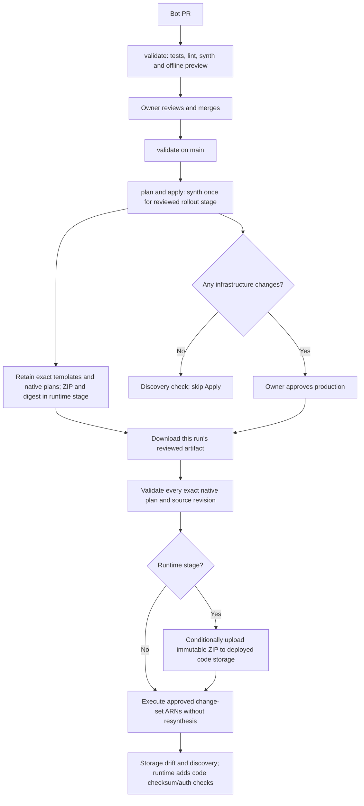

# Obsidian workflow infrastructure

AWS CDK infrastructure for a private Obsidian knowledge base and its staged
ChatGPT MCP integration. GitHub holds code and IaC, never notes or credentials.

## Architecture

One TypeScript CDK application defines the infrastructure. Existing native stack
boundaries keep resource identities and scoped permissions stable.



The application implements `list_notes`, `search_notes`, and `read_note`.
ChatGPT browses one folder page, chooses note paths, then retrieves or searches
only those notes. There is no whole-vault scan, recursive traversal or index.
The ebook library is outside the MCP reader's scope.

The diagram shows the complete architecture. Deployment advances through the
reviewed stage in [config/mcp-deployment.json](config/mcp-deployment.json):
`identity` publishes the pool ARN export, `code-storage` creates deployment
storage, and `runtime` adds the endpoint. Complete each stage's approved Apply
before advancing, with the separate IAM update after the identity export.
Local SDK, JWT and packaging tests do not establish live ChatGPT compatibility.
The committed runtime configuration denies all note access until an owner is
allowlisted; OAuth remains disabled until the exact ChatGPT callback is reviewed.

The authoritative definitions and settings live in the
[CDK app](bin/infrastructure.ts), [infrastructure modules](infra/), and
[versioned configuration](config/). Resource inventory, properties and import
mappings belong there rather than in a duplicated README inventory.

## CI pipeline

The repository uses two workflows: [validate](.github/workflows/ci.yml) and
[plan and apply](.github/workflows/plan-and-apply.yml).



CI authenticates to AWS through GitHub OIDC. One combined Plan and one production
approval cover the business stacks. Apply uses the verified source revision and
existing change sets without resynthesis. CloudFormation executes each stack
independently, so a later failure can leave earlier stacks completed.

The IAM foundation is included in the shared synthesis and preview. Permission
updates remain a separate reviewed, approved local SSO operation; ordinary CI
cannot expand its own permissions. Agents create PRs through the configured
GitHub App; the owner reviews, merges and approves AWS changes.

Keep both diagrams aligned with the CDK app and workflows in the same PR whenever
infrastructure or delivery architecture changes.

## Local validation

Use Node 22.18 or newer within Node 22:

```sh
npm ci
npm run check
npm run synth
```

Synthesis writes the complete cloud assembly to `cdk.out`; these commands do not
deploy. Edit the TypeScript/configuration sources, never generated templates.

## Operational guides

- [Deployment, approvals and permission updates](docs/github-actions.md)
- [Cognito compatibility and OAuth rollout](docs/cognito-preflight.md)
- [Selected-note MCP rollout and permission scope](docs/mcp-rollout.md)
- [MCP tools, configuration and ChatGPT connection](docs/mcp-server.md)
- [Storage retention and recovery verification](docs/retention.md)
- [GitHub App identity and credential handling](docs/github-app-identity.md)

## Dependency audit

The pinned CDK library bundles a vulnerable minimatch copy, currently reported
as two moderate findings (minimatch and aws-cdk-lib). The npm override fixes the
separately installed copy, not the bundled one. CDK remains a build-time dependency and is not bundled into the Lambda runtime. Do not use
`npm audit fix --force` to silently downgrade CDK or claim the bundled finding
is resolved. Recheck upstream before publishing.
