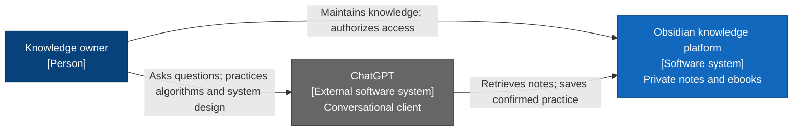
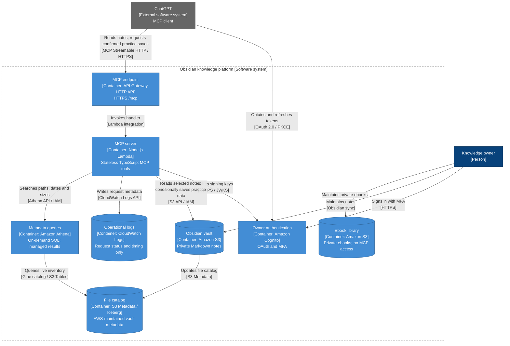

# Obsidian workflow infrastructure

AWS CDK infrastructure for a private Obsidian knowledge base and its staged
ChatGPT MCP integration. GitHub holds code and IaC, never notes or credentials.

## Architecture

The C4 views below describe the intended runtime architecture. Deployment is
staged; see the [rollout guide](docs/mcp-rollout.md#review-and-deployment-order)
for the current stage and prerequisites.

### C1: System context

The owner maintains a private knowledge base and uses ChatGPT to ask questions
about selected notes and complete Algorithm and System Design practice with
confirmed saving.



### C2: Containers

The platform separates authentication, the MCP endpoint, note access and
private storage. C4 containers represent applications and data stores, not
Docker containers.



The application implements `list_notes`, `search_notes`, and `read_note`, with
optional `search_note_metadata` through Athena over S3 Metadata, plus
Algorithm and System Design practice with due reviews followed by new problems.
Generic practice shows due work across available domains and waits for a choice;
explicit domain requests start directly.
Practice coaching and queue reads reuse the same authenticated Lambda and S3
containers. The configuration enables confirmed saving on approved practice
paths, subject to the separate IAM and application activation steps. See
[practice through MCP](docs/practice.md) for its tools and activation checks.
ChatGPT browses one folder page, chooses note paths, then retrieves or searches
only those notes. Metadata search can discover paths across the vault without
reading bodies or recursively listing folders. Its inventory typically updates
within one hour. See [metadata search](docs/metadata-search.md) for continuation,
costs and activation prerequisites. No content index is built.
The MCP server reads selected vault notes and can conditionally write only
approved Algorithm and System Design practice notes and review records after
activation. It has no access to the ebook library. See the
[connection guide](docs/mcp-server.md#owner-setup-and-chatgpt-connection)
for owner authorization and OAuth setup.

Keep these C1 and C2 views aligned with changes to the system's users,
integrations, applications and data stores. Authoritative definitions and
settings live in the [CDK app](bin/infrastructure.ts),
[infrastructure modules](infra/), and [versioned configuration](config/).

## Local validation

Use Node 22.18 or newer within Node 22:

```sh
npm ci
npm run check
npm run synth
```

The tool-schema interoperability test also uses Python 3's standard-library
regex engine. It needs no Python packages and is not part of the Lambda runtime.

Synthesis writes the cloud assembly for the configured stage to `cdk.out`;
these commands do not deploy. Edit the TypeScript/configuration sources, never
generated templates.

## Operational guides

- [Deployment, approvals and permission updates](docs/github-actions.md)
- [Cognito compatibility and OAuth rollout](docs/cognito-preflight.md)
- [Selected-note MCP rollout and permission scope](docs/mcp-rollout.md)
- [Practice workflow, review queues and staged note saving](docs/practice.md)
- [MCP tools, configuration and ChatGPT connection](docs/mcp-server.md)
- [Athena and S3 Metadata file discovery](docs/metadata-search.md)
- [Storage retention and recovery verification](docs/retention.md)
- [GitHub App identity and credential handling](docs/github-app-identity.md)

## Dependency audit

The pinned CDK library bundles a vulnerable minimatch copy, currently reported
as two moderate findings (minimatch and aws-cdk-lib). The npm override fixes the
separately installed copy, not the bundled one. CDK remains a build-time dependency and is not bundled into the Lambda runtime. Do not use
`npm audit fix --force` to silently downgrade CDK or claim the bundled finding
is resolved. Recheck upstream before publishing.

The build tools also inherit the high-severity picomatch advisory
[GHSA-fc5q-39xc-vjpf](https://github.com/advisories/GHSA-fc5q-39xc-vjpf), affecting
all published versions through 4.0.7 with no patched release as of 2026-11-18.
It is not in the Lambda bundle; its lint/test glob patterns come from this
repository. This remains an unresolved vulnerability, not a dependency fix.

Run `npm run audit:ci` locally and in CI. It first runs the runtime dependency
audit without exceptions, failing on every high/critical advisory. It then uses
pinned `audit-ci` to check the entire dependency tree at the same threshold,
with one explicit build-tool exception in [audit-ci.jsonc](audit-ci.jsonc).
That exception names only GHSA-fc5q-39xc-vjpf, remains visible in audit output,
and expires on 2026-12-18 UTC. Every other high/critical advisory still fails.
A runtime occurrence of the same advisory also fails the first audit. Remove
the exception and upgrade when an upstream patch is published; expiry requires
renewed review if there is still no fix. Do not use a package-wide exemption,
raise the severity threshold, or blanket-ignore audit failures.
