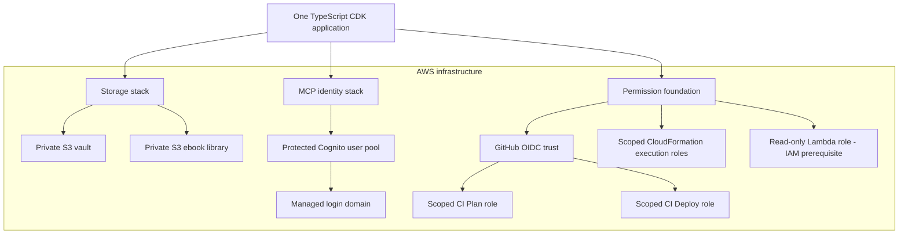
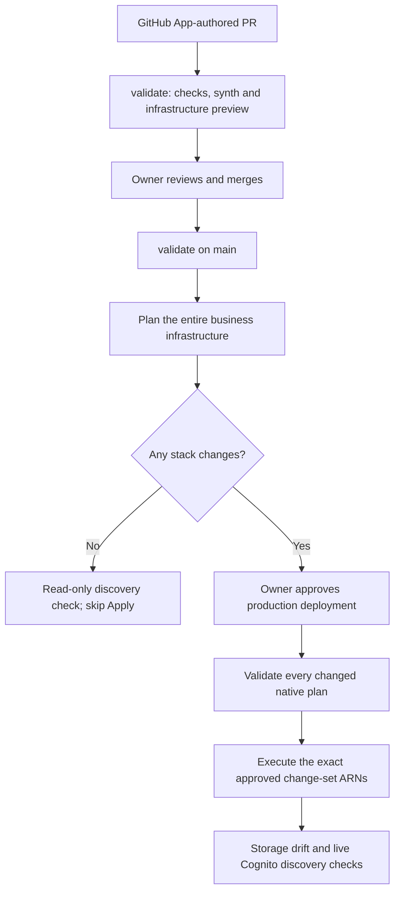

# Obsidian workflow infrastructure

AWS CDK infrastructure for a private Obsidian knowledge base and its staged
ChatGPT MCP integration. GitHub holds code and IaC, never notes or credentials.

## Architecture

One TypeScript CDK application defines the infrastructure. Existing native stack
boundaries keep resource identities and scoped permissions stable.



Storage and the Cognito identity probe are deployed. The MCP Lambda/API runtime,
OAuth client integration and ChatGPT connection are the next stage; this
infrastructure does not yet provide note-reading tools to ChatGPT.

The authoritative definitions and settings live in the
[CDK app](bin/infrastructure.ts), [infrastructure modules](infra/), and
[versioned configuration](config/). Resource inventory, properties and import
mappings belong there rather than in a duplicated README inventory.

## CI pipeline

The repository uses two workflows: [validate](.github/workflows/ci.yml) and
[plan and apply](.github/workflows/plan-and-apply.yml).



CI authenticates to AWS through GitHub OIDC. One combined Plan and one production
approval cover the business stacks. Apply uses the verified source revision and
existing change sets without resynthesis. CloudFormation executes each stack
independently, so a later failure can leave earlier stacks completed.

The IAM foundation is included in the shared synthesis and preview. Permission
updates remain a separate reviewed, approved local SSO operation; ordinary CI
cannot expand its own permissions. Agents create PRs through the configured
GitHub App; the owner reviews, merges and approves AWS changes.

Keep both diagrams aligned with the CDK app and workflows in the same PR whenever
infrastructure or delivery architecture changes.

## Local validation

Use Node 22.18 or newer within Node 22:

```sh
npm ci
npm run check
npm run synth
```

Synthesis writes the complete cloud assembly to `cdk.out`; these commands do not
deploy. Edit the TypeScript/configuration sources, never generated templates.

## Operational guides

- [Deployment, approvals and permission updates](docs/github-actions.md)
- [Cognito compatibility and OAuth rollout](docs/cognito-preflight.md)
- [Selected-note MCP rollout and permission scope](docs/mcp-rollout.md)
- [Storage retention and recovery verification](docs/retention.md)
- [GitHub App identity and credential handling](docs/github-app-identity.md)

## Dependency audit

The pinned CDK library bundles a vulnerable minimatch copy, currently reported
as two moderate findings (minimatch and aws-cdk-lib). The npm override fixes the
separately installed copy, not the bundled one. No dependency is deployed as
application runtime by these infrastructure-only stacks. Do not use
`npm audit fix --force` to silently downgrade CDK or claim the bundled finding
is resolved. Recheck upstream before publishing.
