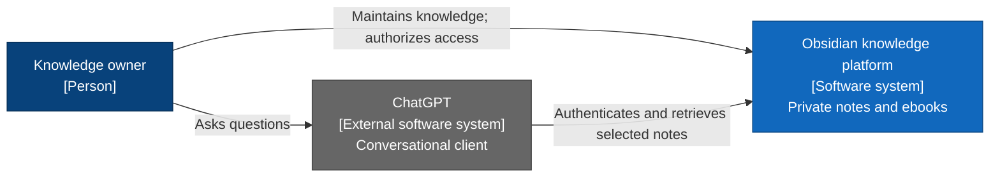
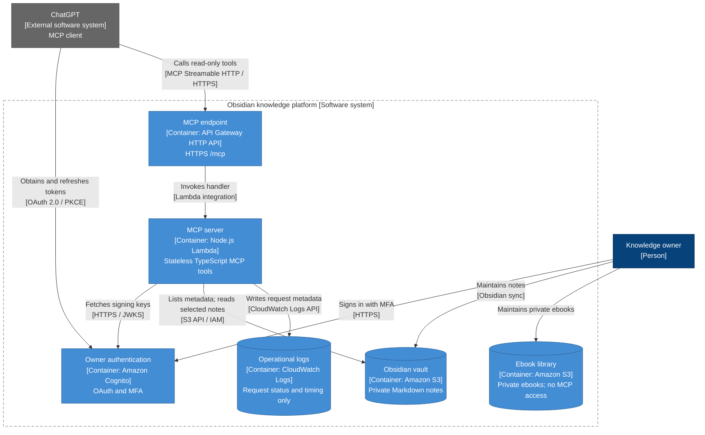

# Obsidian workflow infrastructure

AWS CDK infrastructure for a private Obsidian knowledge base and its staged
ChatGPT MCP integration. GitHub holds code and IaC, never notes or credentials.

## Architecture

The C4 views below describe the intended runtime architecture. Deployment is
staged; see the [rollout guide](docs/mcp-rollout.md#review-and-deployment-order)
for the current stage and prerequisites.

### C1: System context

The owner maintains a private knowledge base and uses ChatGPT to ask questions
about selected notes.



### C2: Containers

The platform separates authentication, the MCP endpoint, note retrieval and
private storage. C4 containers represent applications and data stores, not
Docker containers.



The application implements `list_notes`, `search_notes`, and `read_note`.
ChatGPT browses one folder page, chooses note paths, then retrieves or searches
only those notes. There is no whole-vault scan, recursive traversal or index.
The MCP server has read-only access to the vault and no access to the ebook
library. See the [connection guide](docs/mcp-server.md#owner-setup-and-chatgpt-connection)
for owner authorization and OAuth setup.

Keep these C1 and C2 views aligned with changes to the system's users,
integrations, applications and data stores. Authoritative definitions and
settings live in the [CDK app](bin/infrastructure.ts),
[infrastructure modules](infra/), and [versioned configuration](config/).

## Local validation

Use Node 22.18 or newer within Node 22:

```sh
npm ci
npm run check
npm run synth
```

Synthesis writes the cloud assembly for the configured stage to `cdk.out`;
these commands do not deploy. Edit the TypeScript/configuration sources, never
generated templates.

## Operational guides

- [Deployment, approvals and permission updates](docs/github-actions.md)
- [Cognito compatibility and OAuth rollout](docs/cognito-preflight.md)
- [Selected-note MCP rollout and permission scope](docs/mcp-rollout.md)
- [MCP tools, configuration and ChatGPT connection](docs/mcp-server.md)
- [Storage retention and recovery verification](docs/retention.md)
- [GitHub App identity and credential handling](docs/github-app-identity.md)

## Dependency audit

The pinned CDK library bundles a vulnerable minimatch copy, currently reported
as two moderate findings (minimatch and aws-cdk-lib). The npm override fixes the
separately installed copy, not the bundled one. CDK remains a build-time dependency and is not bundled into the Lambda runtime. Do not use
`npm audit fix --force` to silently downgrade CDK or claim the bundled finding
is resolved. Recheck upstream before publishing.
