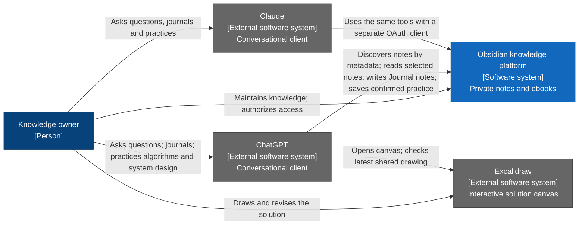
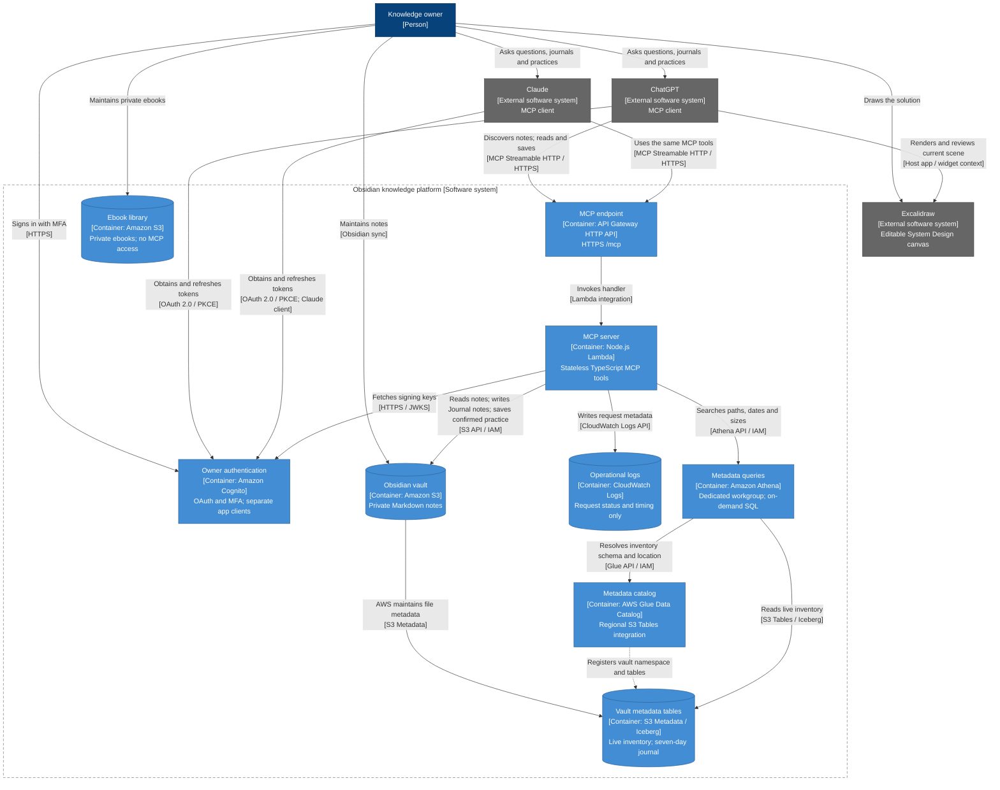

# Obsidian workflow infrastructure

AWS CDK infrastructure for a private Obsidian knowledge base and its staged
ChatGPT and Claude MCP integrations. GitHub holds code and IaC, never notes or
credentials.

## Architecture

The C4 views below describe the intended runtime architecture. Deployment is
staged; see the [rollout guide](docs/mcp-rollout.md#review-and-deployment-order)
for the current stage and prerequisites.

### C1: System context

The owner maintains a private knowledge base and uses ChatGPT or Claude to
discover notes by path, date and size, ask questions about selected notes, write
to the Journal folder, and complete Algorithm and System Design practice with
confirmed saving. System Design
solutions in ChatGPT are drawn in an Excalidraw canvas and reviewed through chat.



### C2: Containers

The platform separates authentication, the MCP endpoint, note access, metadata
queries and private storage. C4 containers represent applications and data
stores, not Docker containers.



- **Notes:** `list_notes`, `search_notes` and `read_note` browse one folder page
  and read or search only selected notes. The server cannot access the ebook
  library.
- **Metadata search:** optional `search_note_metadata` finds paths by date and
  size through Athena over S3 Metadata, without reading note bodies. See
  [metadata search](docs/metadata-search.md).
- **Journal:** `journal_write` appends to or overwrites Markdown notes under
  `Journal/` only, creating them when absent. See [Journal writes](docs/journal.md).
- **Practice:** Algorithm and System Design coaching with due reviews, and
  confirmed saves limited to approved practice paths. ChatGPT reviews System
  Design solutions in an Excalidraw canvas. See [practice](docs/practice.md).
- **Access:** ChatGPT and Claude each have their own Cognito OAuth client for the
  same MFA-protected owner. See the [connection guide](docs/mcp-server.md).

Keep these C1 and C2 views aligned with changes to the system's users,
integrations, applications and data stores. Authoritative definitions and
settings live in the [CDK app](bin/infrastructure.ts),
[infrastructure modules](infra/), and [versioned configuration](config/).

## Local validation

Use Node 22.18 or newer within Node 22:

```sh
npm ci
npm run check
npm run synth
```

The tool-schema test also needs Python 3 (standard library only). These commands
do not deploy; `synth` writes generated templates to `cdk.out`, which you should
never edit by hand.

## Operational guides

- [Deployment, approvals and permission updates](docs/github-actions.md)
- [Cognito compatibility and OAuth rollout](docs/cognito-preflight.md)
- [Selected-note MCP rollout and permission scope](docs/mcp-rollout.md)
- [Practice workflow, review queues and staged note saving](docs/practice.md)
- [Practice review index: indexer, deployment order and operation](docs/practice-index.md)
- [Journal writes](docs/journal.md)
- [MCP tools, configuration and ChatGPT / Claude connections](docs/mcp-server.md)
- [Athena and S3 Metadata file discovery](docs/metadata-search.md)
- [Storage retention and recovery verification](docs/retention.md)
- [GitHub App identity and credential handling](docs/github-app-identity.md)

## Dependency audit

`npm run audit:ci` (also in CI) fails on any high or critical advisory in runtime
dependencies, then audits the full tree with one build-tool exception. Known,
unresolved findings, none of which are in the Lambda bundle:

- **minimatch inside `aws-cdk-lib`:** two moderate findings. The npm override
  fixes only the separately installed copy.
- **picomatch [GHSA-fc5q-39xc-vjpf](https://github.com/advisories/GHSA-fc5q-39xc-vjpf):**
  high, no upstream patch. Allowed only in [audit-ci.jsonc](audit-ci.jsonc)
  until 2026-12-18 UTC; upgrade and remove the exception once a fix ships.

Do not run `npm audit fix --force`, widen exceptions, or raise the threshold to
silence findings.
